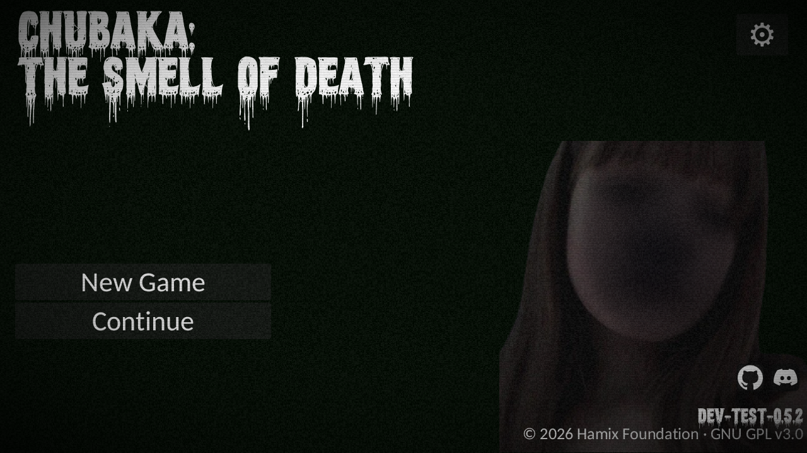

<div align="center">

# Chubaka: The Smell Of Death

**A first-person horror game built with the Lysyk Engine**

[](https://python.org)
[](https://rust-lang.org)
[](https://wgpu.rs/)
[](docs/ANDROID.md)

A night shift at school. A classroom that should be empty. A door that will not stay shut.



</div>

## About

Chubaka is a first-person horror game set during a night shift at a school. Explore a detailed classroom, watch the door, manage your flashlight, and find out what is moving in the corridor.

The game runs on **Lysyk Engine**, a Python-facing engine with a Rust and `wgpu` rendering core. Desktop rendering uses Vulkan or OpenGL; the Android build runs as a native activity.

## Get started

### Requirements

- Python 3.9 or newer
- Rust 1.85 or newer and a working Vulkan or OpenGL driver
- For Android builds: JDK 17, Android SDK command-line tools, Android NDK, and `cargo-ndk`

### Desktop

```bash
python3 -m venv .venv
source .venv/bin/activate
python -m pip install --upgrade pip
python -m pip install -e ".[dev]"
python -m chubaka
```

You can also run `python main.py` from the repository root.

### Android

```bash
./android/build.sh release
```

The APK is written to `build/android/chubaka-release.apk`. Use `./android/build.sh debug` for a debug APK. Setup details and environment variables are in [docs/ANDROID.md](docs/ANDROID.md).

## Controls

| Action | Keyboard / mouse | Touch |
| --- | --- | --- |
| Look around | Mouse | Drag |
| Interact | Left click | Tap |
| Hold the door | Hold left mouse button or Space | Touch and hold |
| Toggle flashlight | Right mouse button or F | On-screen button |
| Return to the desk | S | On-screen button |
| Fullscreen | F11 | — |
| Performance overlay | F3 | — |
| Screenshot | F12 | — |
| Return to title | Esc | — |

## Settings and version

Change the game version, publisher, copyright year, displayed license, and social links in [`chubaka/config.json`](chubaka/config.json). The version and copyright are shown in the title screen and the About page; social links power the GitHub and Discord buttons.

The settings menu supports Ukrainian and English. It stores player preferences and audio levels in the platform's user data directory.

## Project layout

```text
android/           Android manifest, Gradle project, and build script
assets/            Shared fonts and source assets
chubaka/           Game, scenes, localized UI, and game assets
lysyk/
  audio/            Python audio mixer
  engine/           Python engine API and game-facing systems
  native/           Rust + wgpu engine crate
  profile.py        Graphics quality presets
tools/              Asset, video, and model tools
tests/              Engine and gameplay tests
docs/               Android guide and project documentation
```

The Rust crate is kept under `lysyk/native/` alongside the Python engine package. `pyproject.toml` and `android/build.sh` both point to that location.

## Development

Build the Python extension after changing Rust code:

```bash
maturin develop --release
```

Run the test suite with:

```bash
python -m pytest
```

Convert a supported video source into one `.lyv` file with embedded audio:

```bash
python tools/make_video.py input.ogv output.lyv
```

## Links

- [GitHub repository](https://github.com/Hamix-Foundation/chubaka-sod)
- [Discord community](https://discord.gg/kEKhRRPr7)
- [Android build guide](docs/ANDROID.md)
